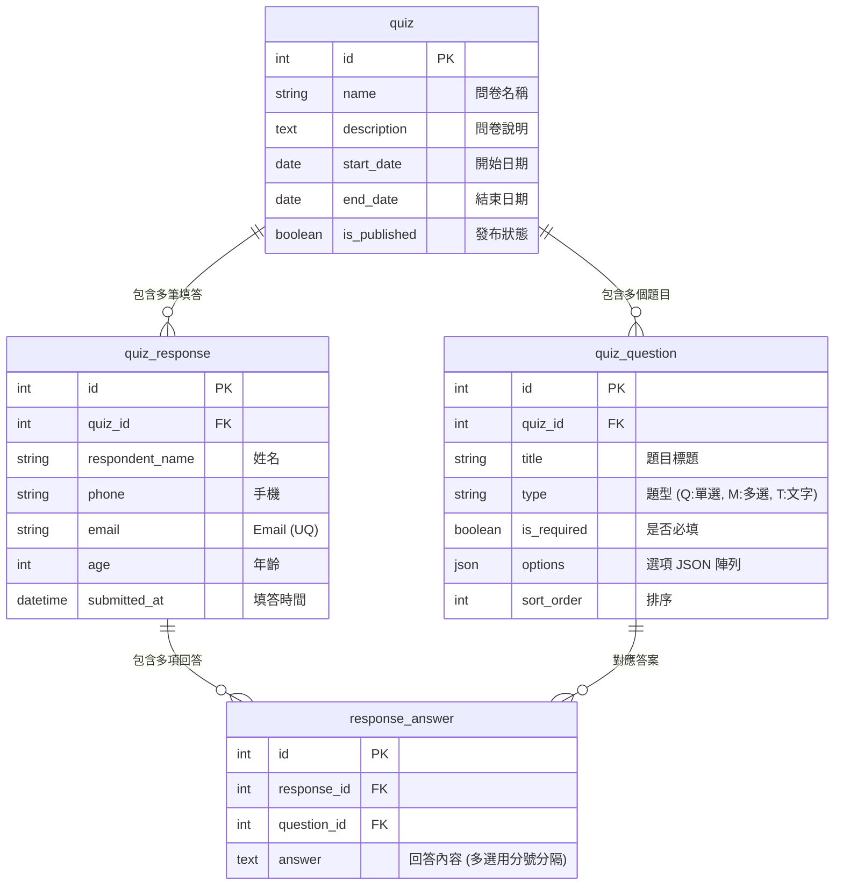
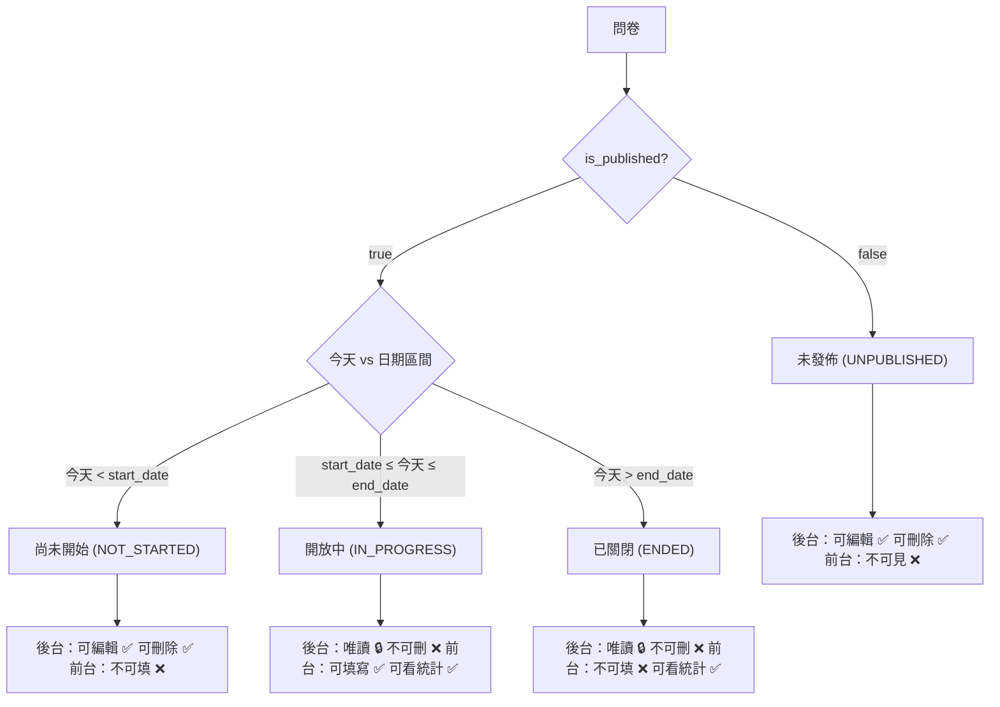

# 📊 動態問卷管理系統 (Dynamic Survey Management System)

> 一個基於 **Angular 17** + **Java Spring Boot 3** + **MySQL 8.0** 的全棧 Docker 容器化問卷系統。提供完整的問卷生命週期管理、動態題目設計、前台作答與 Session 預覽、問卷回饋紀錄、以及基於 Chart.js 的圓餅圖/長條圖統計分析。

---

## 📖 目錄
- [一、快速啟動指南 (Quick Start)](#一快速啟動指南-quick-start)
- [二、API 測試與 Swagger UI 說明](#二api-測試與-swagger-ui-說明)
- [三、專案目錄結構與檔案修改位置指引](#三專案目錄結構與檔案修改位置指引)
- [四、資料庫 Schema 設計 (Database Schema)](#四資料庫-schema-設計-database-schema)
- [五、前後端架構設計 (Architecture Design)](#五前後端架構設計-architecture-design)
  - [1. 前端架構與設計系統](#1-前端架構與設計系統)
  - [2. 問卷狀態狀態機 (Status Logic)](#2-問卷狀態狀態機-status-logic)
  - [3. 後端架構與效能優化](#3-後端架構與效能優化)

---

## 一、快速啟動指南 (Quick Start)

本專案使用 **Docker Compose** 進行全容器化編排，無需手動安裝 Java 或 MySQL 即可一鍵啟動。

### 1. 啟動指令

請在專案根目錄執行：

```bash
docker compose up -d --build
```

### 2. 服務入口網址

| 服務描述 | URL 入口 | 說明 |
|---------|---------|------|
| **🌐 前台與後台 Web 介面** | [http://localhost](http://localhost) | Nginx 託管之 Angular 前端 |
| **⚙️ Swagger UI 介面** | [http://localhost:8080/swagger-ui/index.html](http://localhost:8080/swagger-ui/index.html) | 圖形化 API 點擊測試 |
| **🔧 後端 RESTful API 基礎入口** | [http://localhost:8080/api/quiz](http://localhost:8080/api/quiz) | Spring Boot 後端 |
| **🗄️ MySQL 資料庫** | `localhost:3306` | User: `root` / Pass: `rootpassword` / DB: `survey_db` |

---

## 二、API 測試與 Swagger UI 說明

### 網頁介面測試 (Swagger UI)

我們已整合 Open API 3.0 標準的 **Swagger UI** 介面。

- **存取網頁**：[http://localhost:8080/swagger-ui/index.html](http://localhost:8080/swagger-ui/index.html)
- **測試步驟**：
  1. 在網頁畫面上點擊展開想測試的 API（例如 `GET /api/quiz` 或 `POST /api/quiz/{id}/response`）。
  2. 點擊右上角 **`Try it out`** 按鈕。
  3. 填入 Query 參數或 Request Body JSON 內容。
  4. 點擊 **`Execute`** 即可在網頁直接看到 Response Code (200 OK) 與 JSON 輸出。

---

### RESTful API 規格對照表

#### 1. 前台 API (`/api/quiz`)

| Method | Endpoint | 說明 | 參數 / Body 範例 |
|--------|----------|------|------------------|
| `GET` | `/api/quiz` | 前台問卷列表 (搜尋+分頁) | `?name=青春&startDate=2023-01-01&endDate=2030-12-31&page=0&size=10` |
| `GET` | `/api/quiz/{id}` | 前台問卷詳情 (含題目) | Path: `id=1` |
| `GET` | `/api/quiz/{id}/check-email` | 檢查 Email 是否已重複填答 | `?email=happy@gmail.com` |
| `POST` | `/api/quiz/{id}/response` | 提交填答紀錄 (寫入 DB) | `{ "respondentName": "張三", "phone": "0911222333", "email": "test@gmail.com", "age": 20, "answers": [...] }` |
| `GET` | `/api/quiz/{id}/statistics` | 前台統計數據 (圓餅圖/長條圖票數與百分比) | Path: `id=1` |

#### 2. 後台 API (`/api/admin/quiz`)

| Method | Endpoint | 說明 | 參數 / Body 範例 |
|--------|----------|------|------------------|
| `GET` | `/api/admin/quiz` | 後台問卷列表 (含草稿/未發佈) | `?name=搜尋關鍵字&page=0&size=10` |
| `POST` | `/api/admin/quiz` | 新增/修改問卷 (含題目設計與發佈開關) | `{ "id": null, "name": "新問卷", "description": "說明", "startDate": "2026-08-01", "endDate": "2026-08-31", "isPublished": true, "questions": [...] }` |
| `POST` | `/api/admin/quiz/delete` | 批量刪除問卷 (限未發佈或尚未開始) | Body JSON 陣列: `[1, 2, 3]` |
| `GET` | `/api/admin/quiz/{id}/responses` | 後台問卷回饋填答紀錄列表 | `?page=0&size=10` |
| `GET` | `/api/admin/quiz/response/{responseId}` | 取得單筆作答明細 (唯讀) | Path: `responseId=1` |
| `GET` | `/api/admin/quiz/{id}/statistics` | 後台統計數據展示 | Path: `id=1` |

---

## 三、專案目錄結構與檔案修改位置指引

```
forum practice/
├── docker-compose.yml                  # ⚙️ 修改：容器對外 Port, 數據庫環境變數
├── init.sql                            # 🗄️ 修改：MySQL 建表 SQL, 欄位屬性, 測試資料
├── backend/                            # ☕ 後端專案 (Java 17 + Spring Boot 3)
│   ├── Dockerfile                      # 後端容器打包規則
│   ├── pom.xml                         # ⚙️ 修改：Maven 依賴套件 (新增套件時在此修改)
│   └── src/main/
│       ├── java/com/survey/
│       │   ├── SurveyApplication.java  # Spring Boot 啟動類別
│       │   ├── common/
│       │   │   └── GlobalExceptionHandler.java # 🛠️ 修改：全域例外處理 (如自訂錯誤訊息)
│       │   ├── config/
│       │   │   └── CorsConfig.java     # 🛠️ 修改：跨域 CORS 設定
│       │   ├── controller/             # 🌐 修改：API 路由與 HTTP 請求接收
│       │   │   ├── FrontQuizController.java  # 前台 API 路由 (/api/quiz)
│       │   │   └── AdminQuizController.java  # 後台 API 路由 (/api/admin/quiz)
│       │   ├── dto/                    # 📦 修改：前後端資料傳輸物件 (Data Transfer Objects)
│       │   │   ├── QuizListDto.java
│       │   │   ├── QuizDetailDto.java
│       │   │   ├── QuizSaveRequestDto.java
│       │   │   ├── ResponseSubmitDto.java
│       │   │   └── QuizStatisticsDto.java
│       │   ├── entity/                 # 🗄️ 修改：JPA 資料庫實體 Mapping (ORM)
│       │   │   ├── Quiz.java
│       │   │   ├── QuizQuestion.java
│       │   │   ├── QuizResponse.java
│       │   │   └── ResponseAnswer.java
│       │   ├── enums/                  # 🛠️ 修改：問卷狀態 (QuizStatus) 與題型 (QuestionType)
│       │   │   ├── QuizStatus.java
│       │   │   └── QuestionType.java
│       │   ├── repository/             # 🔍 修改：SQL 查詢與 JPA 存取層
│       │   │   ├── QuizRepository.java
│       │   │   ├── QuizQuestionRepository.java
│       │   │   ├── QuizResponseRepository.java
│       │   │   └── ResponseAnswerRepository.java
│       │   └── service/                # 🧠 修改：核心業務邏輯與百分比計算
│       │       ├── QuizService.java      # 前台作答邏輯
│       │       ├── AdminQuizService.java # 後台編輯與權限驗證
│       │       └── StatisticsService.java# 統計與圓餅圖數據計算 (已優化 N+1 查詢)
│       └── resources/
│           └── application.yml         # ⚙️ 修改：Spring Boot 數據源、埠號設定
└── frontend/                           # 🅰️ 前端專案 (Angular 17 + Chart.js)
    ├── Dockerfile                      # 前端 Nginx 打包規則
    ├── nginx.conf                      # ⚙️ 修改：Nginx 反向代理與 SPA 路由映射
    ├── package.json                    # ⚙️ 修改：前端 npm 依賴套件
    └── src/
        ├── index.html                  # 網頁入口 HTML
        ├── styles.css                  # 🎨 修改：全局 CSS 設計系統 (變數, 卡片, 按鈕, 表格, 彈窗)
        └── app/
            ├── components/             # 🧩 通用元件
            │   ├── navbar/             # 導覽列元件
            │   └── chart-view/         # 📊 修改：Chart.js 圖表元件 (圓餅圖 / 長條圖)
            ├── core/
            │   ├── models/             # 📦 修改：TypeScript 資料型態定義 (survey.model.ts)
            │   └── services/           # 🌐 修改：前端 HTTP Service (quiz.service.ts, admin-quiz.service.ts)
            └── pages/                  # 📄 修改：各個功能頁面 HTML / TS
                ├── client/
                │   ├── quiz-list/      # 前台列表頁 (搜尋 + 分頁)
                │   ├── quiz-form/      # 前台作答頁 (固定欄位 + 動態題目 + Session 暫存)
                │   ├── quiz-confirm/   # 前台作答確認頁 (唯讀預覽 + 送出寫入 DB)
                │   └── quiz-stats/     # 前台統計分析頁 (文字 + 圖表)
                └── admin/
                    ├── admin-list/     # 後台列表頁 (批量刪除 + 編輯/唯讀切換)
                    ├── admin-edit/     # 後台內頁1-精靈編輯器 (問卷/題目JSON/確認頁)
                    ├── admin-detail/   # 後台內頁2-唯讀內頁 (問卷/題目/回饋/統計 Tab)
                    └── admin-feedback/ # 後台問卷回饋頁 (填答紀錄與明細)
```

---

## 四、資料庫 Schema 設計 (Database Schema)

資料庫採用 MySQL 8.0，表結構與索引設計如下：



### 建表 SQL 腳本一覽 (`init.sql`)

```sql
SET NAMES utf8mb4;
SET CHARACTER SET utf8mb4;

CREATE DATABASE IF NOT EXISTS survey_db DEFAULT CHARACTER SET utf8mb4 COLLATE utf8mb4_unicode_ci;
USE survey_db;

-- 1. 問卷主表
CREATE TABLE quiz (
    id INT AUTO_INCREMENT PRIMARY KEY,
    name VARCHAR(255) NOT NULL COMMENT '問卷名稱',
    description TEXT COMMENT '問卷說明',
    start_date DATE NOT NULL COMMENT '開始日期',
    end_date DATE NOT NULL COMMENT '結束日期',
    is_published BOOLEAN DEFAULT FALSE COMMENT '是否發布',
    created_at DATETIME DEFAULT CURRENT_TIMESTAMP,
    updated_at DATETIME DEFAULT CURRENT_TIMESTAMP ON UPDATE CURRENT_TIMESTAMP,
    INDEX idx_quiz_dates (start_date, end_date),
    INDEX idx_quiz_published (is_published),
    INDEX idx_quiz_name (name(50))
) ENGINE=InnoDB DEFAULT CHARSET=utf8mb4 COLLATE=utf8mb4_unicode_ci;

-- 2. 問卷題目表
CREATE TABLE quiz_question (
    id INT AUTO_INCREMENT PRIMARY KEY,
    quiz_id INT NOT NULL,
    title VARCHAR(500) NOT NULL COMMENT '題目標題',
    type VARCHAR(10) NOT NULL COMMENT '題型: Q (單選), M (多選), T (文字)',
    is_required BOOLEAN DEFAULT FALSE COMMENT '是否必填',
    options JSON COMMENT '選項清單 JSON 陣列',
    sort_order INT DEFAULT 0 COMMENT '排序',
    FOREIGN KEY (quiz_id) REFERENCES quiz(id) ON DELETE CASCADE,
    INDEX idx_question_quiz (quiz_id, sort_order)
) ENGINE=InnoDB DEFAULT CHARSET=utf8mb4 COLLATE=utf8mb4_unicode_ci;

-- 3. 填答紀錄表
CREATE TABLE quiz_response (
    id INT AUTO_INCREMENT PRIMARY KEY,
    quiz_id INT NOT NULL,
    respondent_name VARCHAR(100) NOT NULL COMMENT '姓名',
    phone VARCHAR(20) NOT NULL COMMENT '手機',
    email VARCHAR(255) NOT NULL COMMENT 'Email',
    age INT COMMENT '年齡',
    submitted_at DATETIME DEFAULT CURRENT_TIMESTAMP,
    FOREIGN KEY (quiz_id) REFERENCES quiz(id) ON DELETE CASCADE,
    UNIQUE KEY uk_quiz_email (quiz_id, email),
    INDEX idx_response_quiz (quiz_id, id DESC)
) ENGINE=InnoDB DEFAULT CHARSET=utf8mb4 COLLATE=utf8mb4_unicode_ci;

-- 4. 回答明細表
CREATE TABLE response_answer (
    id INT AUTO_INCREMENT PRIMARY KEY,
    response_id INT NOT NULL,
    question_id INT NOT NULL,
    answer TEXT COMMENT '回答內容, 多選用分號 (;) 分隔',
    FOREIGN KEY (response_id) REFERENCES quiz_response(id) ON DELETE CASCADE,
    FOREIGN KEY (question_id) REFERENCES quiz_question(id) ON DELETE CASCADE,
    INDEX idx_answer_question (question_id),
    INDEX idx_answer_response (response_id)
) ENGINE=InnoDB DEFAULT CHARSET=utf8mb4 COLLATE=utf8mb4_unicode_ci;
```

---

## 五、前後端架構設計 (Architecture Design)

### 1. 前端架構與設計系統
- **CSS 變數設計系統**：採用 `styles.css` 統一管理主題色（主色 `--primary: #3b82f6`、圓角 `--radius-md: 10px`、陰影與卡片佈局）。
- **作答暫存與確認機制**：
  1. 使用者在作答頁 (`quiz-form`) 填寫完畢點擊送出。
  2. 前端先驗證 Email 格式與重覆性，並將數據暫存於 `sessionStorage` (`quiz_draft_${id}`)。
  3. 自動切換至確認頁 (`quiz-confirm`) 進行唯讀預覽。
  4. 使用者點擊「確認送出」時，才正式呼叫 API 寫入資料庫。
- **圖表分析**：`app-chart-view` 元件封裝 `Chart.js`，支援**圓餅圖 (Pie Chart)** 優先渲染與**長條圖 (Bar Chart)** 動態按鈕切換。

---

### 2. 問卷狀態狀態機 (Status Logic)

問卷狀態由 `is_published`（發佈開關）、`start_date`（開始日期）與 `end_date`（結束日期）動態計算：



---

### 3. 後端架構與效能優化
- **消除 N+1 查詢**：在 `StatisticsService` 中採用批次一次取回全問卷回答 (`findByQuestionIdIn`)，避免循環 SQL 查詢，極大提升統計計算效率。
- **防止重複填答**：在 DB 層 (`uk_quiz_email`) 與 API 層雙重校驗同一個 Email 不能重複填寫同一張問卷。
- **狀態權限驗證**：在 `AdminQuizService` 的修改與刪除 API 中加入狀態鎖定，進行中與已結束的問卷將強制拋出 `IllegalStateException` 防護。