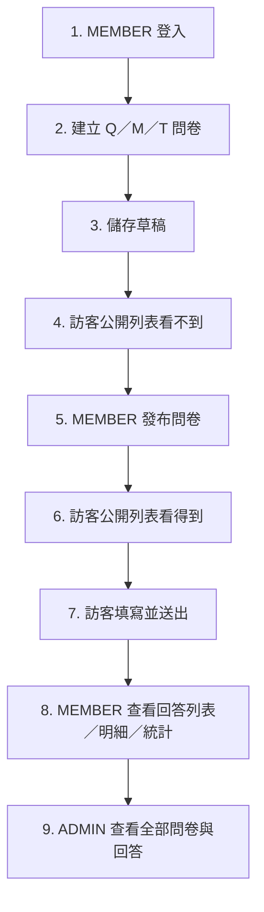

# 動態問卷系統 — 開發者指南

本文件使用繁體中文編寫，目標是：**讓開發者知道要調整哪個功能，就能快速找到對應檔案與驗證方式。**

- 想了解**怎麼啟動專案**？→ [§1 專案總覽](#1-專案總覽)
- 想修改**後端 API、問卷邏輯或權限**？→ [§2 後端結構](#2-後端結構)
- 想修改**Angular 頁面、路由或樣式**？→ [§3 前端結構](#3-前端結構)
- 想知道**某個頁面要改哪裡**？→ [§4 頁面對照表](#4-頁面對照表改哪裡渲染哪裡)
- 想確認**訪客、MEMBER、ADMIN 權限**？→ [§5 認證與權限](#5-認證與權限)
- 想走一次**完整 Demo 流程**？→ [§6 Demo 操作流程](#6-demo-操作流程)
- 想執行**Build 與測試**？→ [§7 驗證與測試](#7-驗證與測試)

---

## 1. 專案總覽

前端使用 Angular，後端使用 Spring Boot REST API，資料儲存在 MySQL：

| 服務 | 技術 | 位置 | 預設埠 |
| :--- | :--- | :--- | :--- |
| `frontend` | Angular 17.2、NgModule、TypeScript 5.3、CSS | [`frontend/`](./frontend/) | `4200` |
| `backend` | Spring Boot 3.2.2、Java 17、Spring Data JPA | [`backend/`](./backend/) | `8080` |
| `database` | MySQL 8.0 | [`db/migration/`](./backend/src/main/resources/db/migration/) | `3306` |

### 1.1 專案目錄

```text
Questionnaire-filling-full-stack/
├── frontend/   # Angular 頁面、Guard、Interceptor、Service 與 Design System
├── backend/    # Spring Boot Controller、Service、Repository、Security 與測試
├── docs/       # 需求、Migration、實作與驗證紀錄
└── docker-compose.yml
```

### 1.2 本機設定

複製資料庫設定範例，再填入自己的 MySQL 連線資訊：

```powershell
Copy-Item backend/src/main/resources/application-local.example.yml `
  backend/src/main/resources/application-local.yml
```

`application-local.yml` 已由 Git 忽略，不得提交。Schema 由 Flyway 管理：後端啟動時自動套用 [`db/migration/`](./backend/src/main/resources/db/migration/) 中尚未執行的 Migration。既有資料庫會先被標記為已套用 `V1` 再往後跑，不會重建資料表。`ddl-auto` 為 `validate`，Entity 與實際 Schema 不一致時啟動即失敗。

後端啟動前必須提供至少 32 UTF-8 bytes 的 JWT Secret：

```powershell
$env:JWT_SECRET = '<由安全工具產生的本機 Secret>'
$env:JWT_EXPIRATION_SECONDS = '86400' # 選填，預設 24 小時
$env:BCRYPT_STRENGTH = '12'           # 選填，預設 12
```

### 1.3 啟動方式

```powershell
# Terminal 1：後端
cd backend
.\mvnw.cmd test
.\mvnw.cmd spring-boot:run "-Dspring-boot.run.profiles=local"

# Terminal 2：前端
cd frontend
npm install
npm start
```

- Angular：<http://localhost:4200>
- API：<http://localhost:8080>
- Swagger：<http://localhost:8080/swagger-ui/index.html>
- 前端 `/api` 由 [`proxy.conf.json`](./frontend/proxy.conf.json) 代理至後端。

### 1.4 本機 Demo 帳號

> 僅供本機開發與展示，禁止用於正式環境。

| 類別 | 帳號 | 密碼 | 角色 | 權限 |
| :--- | :--- | :--- | :--- | :--- |
| 一般會員 | `user@example.com` | `user123` | `MEMBER` | 建立與管理自己的問卷、查看自己的回答與統計 |
| 系統管理員 | `admin@example.com` | `admin123` | `ADMIN` | 查看及管理全部會員問卷、Legacy 問卷、回答與統計 |

兩個帳號只由 `local` Profile 的冪等 Seeder 建立。新帳號使用 BCrypt；既有 Legacy SHA-256 帳號會在第一次成功登入後漸進升級。

---

## 2. 後端結構

後端採 Controller → Service → Repository 分層，DTO 負責 API 資料形狀，Entity 對應 MySQL：

```text
backend/src/main/java/com/survey/
├── config/       # SecurityConfig、CORS 與應用設定
├── security/     # JWT 產生／驗證、Filter、UserPrincipal
├── controller/   # 公開、會員、管理員與認證 API
├── service/      # 問卷、Ownership、填答、統計、會員與認證邏輯
├── repository/   # Spring Data JPA 查詢
├── entity/       # app_user、quiz、question、response、answer 映射
├── dto/          # Request／Response DTO
├── common/       # 統一例外與錯誤回傳
└── enums/        # 問卷狀態等列舉
```

### 2.1 常改的幾個點

| 想做的事 | 改哪裡 |
| :--- | :--- |
| 開放或限制某支 API | [`SecurityConfig.java`](./backend/src/main/java/com/survey/config/SecurityConfig.java) |
| 修改登入、註冊、登出或會員資料 | [`AuthService.java`](./backend/src/main/java/com/survey/service/AuthService.java) 與 [`AuthController.java`](./backend/src/main/java/com/survey/controller/AuthController.java) |
| 修改公開問卷與填答流程 | [`QuizService.java`](./backend/src/main/java/com/survey/service/QuizService.java) 與 [`FrontQuizController.java`](./backend/src/main/java/com/survey/controller/FrontQuizController.java) |
| 修改問卷建立、編輯、刪除或 Ownership | [`QuizManagementService.java`](./backend/src/main/java/com/survey/service/QuizManagementService.java) |
| 修改 MEMBER 管理 API | [`MemberQuizController.java`](./backend/src/main/java/com/survey/controller/MemberQuizController.java) |
| 修改 ADMIN 管理 API | [`AdminQuizController.java`](./backend/src/main/java/com/survey/controller/AdminQuizController.java) |
| 修改回答統計 | [`StatisticsService.java`](./backend/src/main/java/com/survey/service/StatisticsService.java) |
| 修改重複填答規則 | [`SubmissionEligibilityService.java`](./backend/src/main/java/com/survey/service/SubmissionEligibilityService.java) |
| 修改資料表結構 | 於 [`db/migration/`](./backend/src/main/resources/db/migration/) 新增 `V{n}__描述.sql`，不要改既有 Migration |
| 修改展示種子資料 | [`db/seed/V900__seed_demo_data.sql`](./backend/src/main/resources/db/seed/V900__seed_demo_data.sql)（僅 demo 堆疊載入） |
| 修改統一錯誤格式 | [`GlobalExceptionHandler.java`](./backend/src/main/java/com/survey/common/GlobalExceptionHandler.java) |

### 2.2 問卷資料關係

```text
app_user (owner)
    └── quiz
        ├── quiz_question
        └── quiz_response
            └── response_answer
```

- `quiz.owner_id → app_user.id` 使用 `ON DELETE RESTRICT`。
- 導入 Ownership 前的問卷保持 `owner_id = NULL`，視為 Legacy／System 問卷。
- Legacy 問卷只有 ADMIN 可以管理；符合公開條件時仍可供訪客填寫。
- 題目與回答必須透過問卷 Ownership 間接授權，不能只驗證前端是否隱藏按鈕。

### 2.3 安全性設計筆記

- **owner 只相信 Principal**：新增問卷時由後端登入使用者自動指定，Request DTO 不接受 `ownerId`、`userId`、`createdBy` 或角色。
- **MEMBER 只能管理自己的問卷**：清單、明細、修改、刪除、回答與統計都在 Service 層驗證 owner。
- **公開 API 只讀取已發布問卷**：未發布問卷的公開明細與統計回傳 404。
- **同一 Email 不得重複填寫同一份問卷**：後端再次驗證，不依賴前端提示。
- **認證採 Stateless Bearer JWT**：每次 Request 重新載入使用者及目前角色。
- **登出立即撤銷舊 JWT**：`token_version` 增加後，該帳號先前簽發的 Token 立即失效。
- **密碼採 BCrypt**：Legacy SHA-256 只做登入相容，成功登入後自動升級。

---

## 3. 前端結構

Angular 使用 NgModule 架構，頁面大多將 Template 與樣式直接放在 Component TypeScript 中：

```text
frontend/src/app/
├── core/
│   ├── models/       # 與後端 DTO 對齊的 TypeScript 介面
│   ├── services/     # AuthService、QuizService、AdminQuizService
│   ├── auth.guard.ts
│   ├── admin.guard.ts
│   └── auth.interceptor.ts
├── components/
│   ├── navbar/       # 全站導覽列
│   └── chart-view/   # 基礎圓餅圖／長條圖
├── pages/
│   ├── home/         # 首頁
│   ├── auth/         # 登入、註冊
│   ├── member/       # 會員資料
│   ├── client/       # 公開問卷、填答、確認、統計
│   └── admin/        # 共用的會員問卷管理／ADMIN 後台元件
├── app-routing.module.ts
├── app.module.ts
└── app.component.ts
```

### 3.1 常改的幾個點

| 想做的事 | 改哪裡 |
| :--- | :--- |
| 修改全站色彩、按鈕、卡片、表單或表格 | [`styles.css`](./frontend/src/styles.css) |
| 修改首頁 | [`pages/home/`](./frontend/src/app/pages/home/) |
| 修改導覽列與角色選單 | [`navbar.component.ts`](./frontend/src/app/components/navbar/navbar.component.ts) |
| 修改登入／註冊 | [`pages/auth/`](./frontend/src/app/pages/auth/) |
| 修改會員資料 | [`profile.component.ts`](./frontend/src/app/pages/member/profile.component.ts) |
| 修改公開問卷列表或搜尋 | [`quiz-list.component.ts`](./frontend/src/app/pages/client/quiz-list/quiz-list.component.ts) |
| 修改訪客填答與驗證 | [`quiz-form.component.ts`](./frontend/src/app/pages/client/quiz-form/quiz-form.component.ts) |
| 修改送出前確認 | [`quiz-confirm.component.ts`](./frontend/src/app/pages/client/quiz-confirm/quiz-confirm.component.ts) |
| 修改「我的問卷」或 ADMIN 全清單 | [`admin-list.component.ts`](./frontend/src/app/pages/admin/admin-list/admin-list.component.ts) |
| 修改問卷建立／編輯 Wizard | [`admin-edit.component.ts`](./frontend/src/app/pages/admin/admin-edit/admin-edit.component.ts) |
| 修改回答列表／明細 | [`admin-feedback.component.ts`](./frontend/src/app/pages/admin/admin-feedback/admin-feedback.component.ts) |
| 修改唯讀題目與統計頁 | [`admin-detail.component.ts`](./frontend/src/app/pages/admin/admin-detail/admin-detail.component.ts) |
| 修改路由與 Guard | [`app-routing.module.ts`](./frontend/src/app/app-routing.module.ts) |

### 3.2 共用 Service

| Service | 負責什麼 |
| :--- | :--- |
| [`AuthService`](./frontend/src/app/core/services/auth.service.ts) | 登入狀態、目前會員、角色、登出與 Token 保存 |
| [`QuizService`](./frontend/src/app/core/services/quiz.service.ts) | 公開問卷、Email 檢查、填答送出與公開統計 |
| [`AdminQuizService`](./frontend/src/app/core/services/admin-quiz.service.ts) | MEMBER／ADMIN 問卷管理、回答明細與受保護統計 |

HTTP Interceptor 只對站內 `/api` Request 加入 `Authorization: Bearer <JWT>`；不要在各頁自行重複組 Authorization Header。

---

## 4. 頁面對照表（改哪裡渲染哪裡）

| 頁面 | 路由 | 權限 | Component | 改了會影響 |
| :--- | :--- | :--- | :--- | :--- |
| **首頁** | `/`、`/home` | 公開 | [HomeComponent](./frontend/src/app/pages/home/home.component.ts) | Hero、功能介紹、流程、CTA、Footer |
| **公開問卷列表** | `/quiz` | 公開 | [QuizListComponent](./frontend/src/app/pages/client/quiz-list/quiz-list.component.ts) | 搜尋、公開狀態、填答入口 |
| **問卷填答** | `/quiz/:id/form` | 公開 | [QuizFormComponent](./frontend/src/app/pages/client/quiz-form/quiz-form.component.ts) | 基本資料、Q／M／T 題型、必填驗證 |
| **送出確認** | `/quiz/:id/confirm` | 公開 | [QuizConfirmComponent](./frontend/src/app/pages/client/quiz-confirm/quiz-confirm.component.ts) | 回答覆核與正式送出 |
| **公開統計** | `/quiz/:id/stats` | 公開問卷 | [QuizStatsComponent](./frontend/src/app/pages/client/quiz-stats/quiz-stats.component.ts) | 公開問卷基礎統計 |
| **登入** | `/login` | 公開 | [LoginComponent](./frontend/src/app/pages/auth/login.component.ts) | 登入、錯誤提示、returnUrl |
| **註冊** | `/register` | 公開 | [RegisterComponent](./frontend/src/app/pages/auth/register.component.ts) | 註冊與欄位驗證 |
| **會員資料** | `/member/profile` | 已登入 | [ProfileComponent](./frontend/src/app/pages/member/profile.component.ts) | 姓名、手機、密碼更新 |
| **我的問卷** | `/member/quizzes` | MEMBER | [AdminListComponent](./frontend/src/app/pages/admin/admin-list/admin-list.component.ts) | 只顯示自己的全部狀態問卷 |
| **建立／編輯自己的問卷** | `/member/quizzes/new`、`/:id/edit` | MEMBER | [AdminEditComponent](./frontend/src/app/pages/admin/admin-edit/admin-edit.component.ts) | 基本資料、Q／M／T、草稿與發布 |
| **自己的回答與統計** | `/member/quizzes/:id/detail` | MEMBER | [AdminDetailComponent](./frontend/src/app/pages/admin/admin-detail/admin-detail.component.ts) | 題目、回答列表、明細、統計 |
| **ADMIN 問卷清單** | `/admin` | ADMIN | [AdminListComponent](./frontend/src/app/pages/admin/admin-list/admin-list.component.ts) | 所有會員與 Legacy 問卷 |
| **ADMIN 建立／編輯** | `/admin/new`、`/admin/:id/edit` | ADMIN | [AdminEditComponent](./frontend/src/app/pages/admin/admin-edit/admin-edit.component.ts) | 全部問卷管理 |
| **ADMIN 回答與統計** | `/admin/:id/detail` | ADMIN | [AdminDetailComponent](./frontend/src/app/pages/admin/admin-detail/admin-detail.component.ts) | 全部問卷回答與統計 |

路由與 Guard 的完整對應集中在 [`app-routing.module.ts`](./frontend/src/app/app-routing.module.ts)。

---

## 5. 認證與權限

### 5.1 登入流程

```text
登入／註冊
→ 後端驗證 BCrypt 或 Legacy SHA-256
→ Legacy 成功登入後原子升級 BCrypt
→ 回傳 Bearer JWT（sub、iat、exp、tokenVersion）
→ Angular AuthService 保存登入狀態
→ Interceptor 自動附加 Authorization Header
→ JWT Filter 驗證簽章、期限與 tokenVersion
→ 從資料庫重新載入使用者與角色
→ 建立 SecurityContext
→ Controller／Service 執行角色與 Ownership 授權
```

後端不接受 `X-Auth-Token`。未登入或 JWT 無效回傳 401；已登入但無權操作回傳 403。

### 5.2 API 權限矩陣

| API／操作 | 訪客 | MEMBER | ADMIN |
| :--- | :---: | :---: | :---: |
| 登入、註冊 | 可 | 可 | 可 |
| 公開且有效的問卷列表／明細 | 可 | 可 | 可 |
| 填寫公開問卷 | 可 | 可 | 可 |
| `/api/auth/me` | 401 | 自己 | 自己 |
| 建立問卷 | 401 | 可，owner 為本人 | 可，owner 為本人 |
| 管理自己的問卷 | 401 | 可 | 可 |
| 管理其他會員問卷 | 401 | 403 | 可 |
| 管理 Legacy 問卷 | 401 | 403 | 可 |
| 查看自己的問卷回答／統計 | 401 | 可 | 可 |
| 查看其他會員回答／統計 | 401 | 403 | 可 |
| `/api/admin/**` | 401 | 403 | 可 |

### 5.3 Token Version 與密碼

- 登出會增加目前帳號的 `token_version`，讓該帳號所有舊 JWT 立即失效。
- 新註冊與新密碼一律使用帶 `{bcrypt}` 前綴的 BCrypt。
- 已是 BCrypt 的帳號不會在每次登入重新 Hash。
- Legacy SHA-256 只有取得正確原始密碼後才能漸進升級，不能只憑舊 Hash 批次轉換。
- 密碼、完整 JWT、JWT Secret 與 Hash 不得輸出到 README、Log 或 API Response。

---

## 6. Demo 操作流程

目前保留 Demo 問卷 `#10 8-8 Demo Core QMT 1785910401`，包含 Q／M／T 三種題型與一筆填答。初始化資料原有 3 份問卷、其中 2 份公開；本機資料庫在 Demo 問卷有效期間會多顯示一份。



### Demo 檢查重點

1. 草稿只出現在「我的問卷」，公開明細應回傳 404。
2. 發布且日期有效後，問卷才會進入公開列表。
3. Q 單選只能選一項；M 多選可選多項；T 可輸入文字。
4. 必填資料或必填題未完成時不能送出。
5. 同一 Email 再填同一份問卷應被拒絕。
6. MEMBER 只能看自己的回答；第二會員存取應回傳 403。
7. ADMIN 應看得到會員問卷與 `owner_id = NULL` 的 Legacy 問卷。

---

## 7. 驗證與測試

### 7.1 自動化

```powershell
# 後端
cd backend
.\mvnw.cmd test

# 前端型別、Template 與 production Build
cd frontend
npm run build
```

目前驗證基準：

| 項目 | 結果 |
| :--- | :--- |
| Maven | 47 tests，0 failures、0 errors、0 skipped |
| Angular production Build | PASS |
| Hibernate `validate` | PASS |
| 瀏覽器 Console | 0 error／warn |
| JWT 篡改、錯誤密碼、登出舊 Token | 401 |
| MEMBER 呼叫 ADMIN API | 403 |
| ADMIN 管理 API | 200 |

### 7.2 手動回歸

- 訪客：公開列表、草稿不可見、Q／M／T 填答、重複 Email。
- MEMBER：建立、草稿、發布、我的問卷、回答列表、明細、統計、登出。
- 第二 MEMBER：修改或讀取第一位會員問卷應為 403。
- ADMIN：全部狀態問卷、Legacy 問卷、回答與統計。
- MySQL：成功送出只新增一筆 `quiz_response`，每題各有一筆 `response_answer`。

---

## 8. 踩過的地雷（別再踩一次）

### 8.1 不要手改既有 Migration

`db/migration/` 下已執行過的檔案有 checksum 記錄在 `flyway_schema_history`，改動內容會讓下次啟動直接失敗。要改 Schema 一律新增 `V{n}__描述.sql`。

（歷史背景：這個專案原本用根目錄的 `init.sql` 搭配 `ddl-auto: update`。`init.sql` 只在 Docker 資料卷是空的時候跑一次，之後的 Schema 變更等於沒有交付管道，才會演變成「手動比對 `information_schema` 再貼 SQL」。改用 Flyway 後這一段已不需要。）

### 8.2 不要相信前端傳來的 owner 或角色

前端 Payload 即使加入 `ownerId`、`userId`、`createdBy` 或 `role`，後端也必須忽略。問卷 owner 永遠取自 Spring Security Principal，Service 層還要再次驗證目標問卷 owner。

### 8.3 管理明細不能改用公開 API

公開明細只允許已發布問卷。會員編輯草稿、查看私人回答或統計時，要走 `/api/member/**`；ADMIN 要走 `/api/admin/**`。否則草稿會錯誤得到 404，或不小心繞過 Ownership 邊界。

### 8.4 多選答案使用分號分隔

目前 M 題答案以 `選項A;選項B` 儲存，前端顯示時再換成頓號，統計時由後端拆分。若調整格式，填答、回答明細與統計三處必須一起修改。

### 8.5 不要只靠 Navbar 或 Guard 做權限

Angular Guard 與隱藏按鈕只改善操作體驗，使用者仍可直接呼叫 API。真正的安全邊界必須留在 Spring Security、Controller Principal 與 Service Ownership 驗證。

---

## 9. Schema Migration

| Migration | 用途 |
| :--- | :--- |
| [`V20260805__add_token_version.sql`](./docs/requirements/migrations/V20260805__add_token_version.sql) | 新增 JWT 撤銷用 `token_version` |
| [`V20260805_02__expand_password_hash_for_bcrypt.sql`](./docs/requirements/migrations/V20260805_02__expand_password_hash_for_bcrypt.sql) | 將 `password_hash` 擴充為 `VARCHAR(255)` |
| [`V20260805_03__add_quiz_owner.sql`](./docs/requirements/migrations/V20260805_03__add_quiz_owner.sql) | 新增 `quiz.owner_id`、Index 與 `ON DELETE RESTRICT` Foreign Key |

上述三份是導入 Flyway 之前手動套用的歷史紀錄，其結果已包含在 Flyway 的 `V1__baseline_schema.sql` 中。之後的所有 Schema 變更一律走 [`db/migration/`](./backend/src/main/resources/db/migration/)：

| Migration | 用途 |
| :--- | :--- |
| `V1__baseline_schema.sql` | 既有 Schema 基準線；既有 DB 會被標記為已套用而不重跑 |
| `V2__normalize_email_and_constrain_type.sql` | Email 一律存小寫；`quiz_question.type` 加上 CHECK |
| `V3__normalize_options.sql` | 選項獨立成 `quiz_option`；答案改以 `response_answer_option` 連結 |
| `V4__drop_superseded_columns.sql` | 移除 `options` JSON 與只寫不讀的 `normalized_*` 欄位 |

---

## 10. 已知限制與後續項目

| 項目 | 說明 |
| :--- | :--- |
| Logout All Sessions | 任一裝置登出會讓同帳號全部舊 JWT 失效，不是單裝置登出 |
| Logout Request 斷線 | 前端會清除本機狀態，但後端若未收到 Request，被複製的 JWT 可能有效至到期 |
| Refresh Token | 尚未實作 |
| 忘記密碼 Email | 尚未實作 |
| Ownership 轉移／共同編輯 | 尚未實作，目前一份問卷只有一位 owner |
| Audit Log／問卷版本控制 | 尚未實作 |
| 進階統計 | 目前提供回答總數、選項票數、比例與文字回答，尚無進階分析 |
| 手機版 | 本專案目前只要求桌面網頁；390px Navbar 仍可能水平捲動 |
| 原生 `alert()`／`confirm()` | 部分既有操作仍使用，後續可改成行內訊息或自製 Dialog |

---

## 11. 延伸文件

| 主題 | 文件 |
| :--- | :--- |
| 8/8 Demo 核心狀態 | [demo-core-status.md](./docs/requirements/demo-core-status.md) |
| 問卷 Ownership | [實作](./docs/requirements/questionnaire-ownership-implementation.md)／[驗證](./docs/requirements/questionnaire-ownership-verification-report.md) |
| Spring Security JWT | [實作](./docs/requirements/spring-security-jwt-implementation.md)／[驗證](./docs/requirements/spring-security-jwt-verification-report.md) |
| Token Version 撤銷 | [實作](./docs/requirements/token-version-revocation-implementation.md)／[驗證](./docs/requirements/token-version-revocation-verification-report.md) |
| BCrypt 漸進遷移 | [實作](./docs/requirements/bcrypt-migration-implementation.md)／[驗證](./docs/requirements/bcrypt-migration-verification-report.md) |
| 固定測試帳號 | [實作](./docs/requirements/default-test-accounts-implementation.md)／[驗證](./docs/requirements/default-test-accounts-verification-report.md) |
| 角色導覽 | [實作](./docs/requirements/role-navigation-implementation.md)／[驗證](./docs/requirements/role-navigation-verification-report.md) |
| 本機後端環境 | [backend-local-environment.md](./docs/setup/backend-local-environment.md) |
